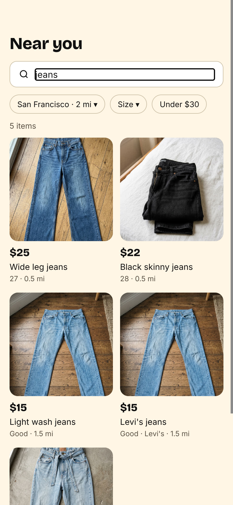

# yardsale

Snap your stuff, set a price, and your yard sale goes live to buyers nearby. Text our iMessage agent a pic to add more.

  
  
  

## Try it (live today during judging)

Install Expo Go on iPhone, then scan.

Or open `exp://vqezwjo-anonymous-8081.exp.direct` in Expo Go.

## Demo video

Coming soon.

## How it works

1. Snap photos of your stuff.
2. AI fills in each listing: title, details and a suggested price.
3. Buyers nearby find it and pay with Whop. Text Keiki a pic to add more.

**Stack:** Expo (iOS), Convex, OpenAI vision, Whop, Keiki.
