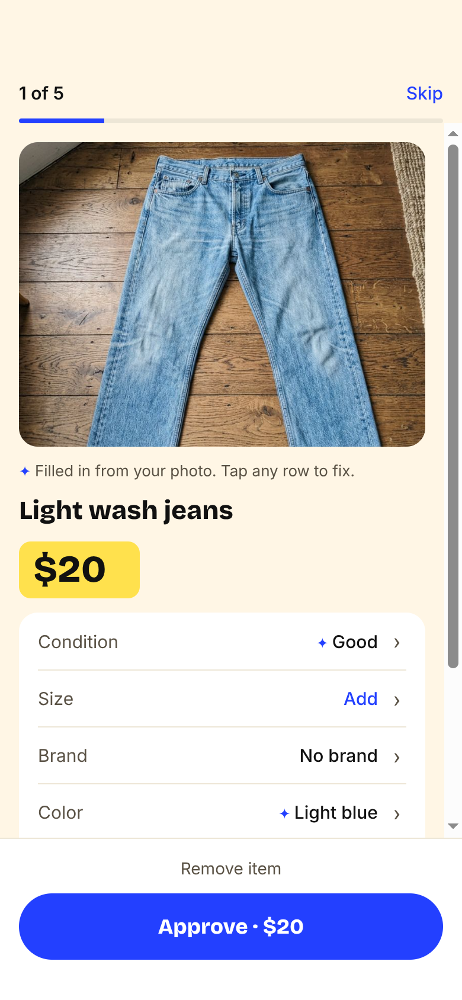
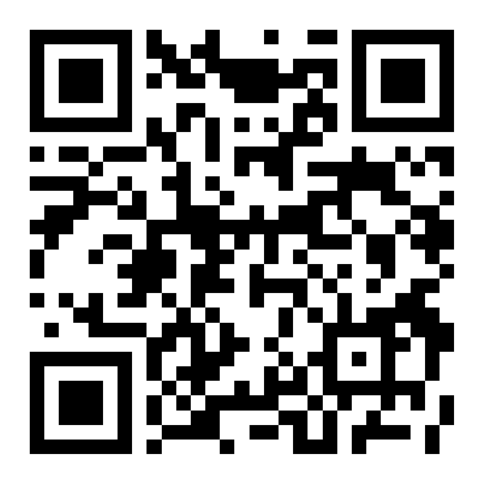

# yardsale

Open your yard sale in a few photos. Sell to friends and neighbors, then keep it going with a text.

  
  
  

## Try it (live today during judging)

Install Expo Go on iPhone, then scan.

Or open `exp://u.expo.dev/abb6ae99-54b9-42bc-b081-7146f18b9808?channel-name=demo&runtime-version=exposdk%3A58.0.0` in Expo Go.

Backup (live dev server, until 6 PM PT):  `exp://vqezwjo-anonymous-8081.exp.direct`

## Demo video

Coming soon.

## How it works
- **Sell:** pick a batch of photos and AI writes every listing. Approve each one with a tap and your yard is live.
- **Shop:** search what's for sale within a few miles, step into a yard, grab a few things and pay.
- **Keep selling:** text a pic when you have something else to sell. We'll confirm the price and use AI to get it listed.

## Notable features
- **Clear out your whole closet:** pick your photos in bulk and get listings back, ready for your approval.
- **Paid before you meet:** buyers check out in the app, and the items are held for them, so pickup is just a handoff.
- **Pickup in one text:** after paying, tap to text the seller. The message already has your items and a pickup question.
- **Live and local:** new listings show up in nearby search instantly, and you only ever see a neighborhood, never an address.
- **Shop locally, keep stuff out of the landfill:** search for anything and find sellers nearby.
- **One yard, one pickup:** buy in bulk from someone's yard and come home with a haul.

**Stack:** Expo (iOS), Convex, OpenAI vision, Whop, Keiki, Revyl, Capy.

### Shared yard and item links

Shared HTTPS links open in Safari. Tap an item on the yard page to read its listing. The page shows **Open in yardsale app** only when the Convex deployment has a `YARDSALE_APP_LINK_BASE` value.

- For an installed yardsale build, set it to `garagesale://`.
- For an Expo Go demo, set it to the running project's link plus `/--/`, for example `exp://192.168.1.10:8084/--/`. The phone needs a route to that Metro server and the same Expo account as the CLI on iOS.
- Leave it unset for public browser previews when a compatible app build is unavailable.
