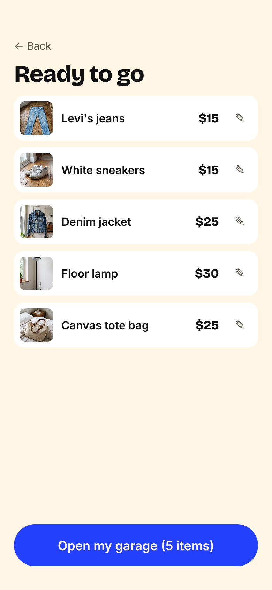

# yardsale

Snap your stuff, set a price, and your yard sale goes live to buyers nearby. Text our iMessage agent a pic to add more.

  
  
  

## Try it (live today during judging)

Install Expo Go on iPhone, then scan.

Or open `exp://u.expo.dev/abb6ae99-54b9-42bc-b081-7146f18b9808?channel-name=demo&runtime-version=exposdk%3A58.0.0` in Expo Go.

Backup (live dev server, until 6 PM PT):  `exp://vqezwjo-anonymous-8081.exp.direct`

## Demo video

Coming soon.

## How it works

1. Snap photos of your stuff.
2. AI fills in each listing: title, details and a suggested price.
3. Buyers nearby find it and pay with Whop. Text Keiki a pic to add more.

**Stack:** Expo (iOS), Convex, OpenAI vision, Whop, Keiki.

### Shared yard and item links

Shared HTTPS links open in Safari. Tap an item on the yard page to read its listing. The page shows **Open in yardsale app** only when the Convex deployment has a `YARDSALE_APP_LINK_BASE` value.

- For an installed yardsale build, set it to `garagesale://`.
- For an Expo Go demo, set it to the running project's link plus `/--/`, for example `exp://192.168.1.10:8084/--/`. The phone needs a route to that Metro server and the same Expo account as the CLI on iOS.
- Leave it unset for public browser previews when a compatible app build is unavailable.
